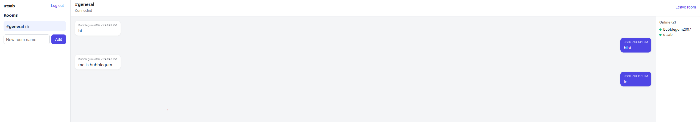

# Realtime Chat

A multi-room chat app with live messaging over WebSockets, message history, online presence, and typing indicators.



## Features

- JWT authentication; sign in with username or email
- Public rooms with explicit membership
- Live messages, presence, and typing indicators over WebSockets
- Persistent history with cursor-based pagination ("load older messages")
- Auto-reconnect with exponential backoff
- Membership re-checked on every message, so leaving a room takes effect immediately

## Tech stack

- **Backend:** FastAPI (WebSockets), SQLAlchemy 2.0, Pydantic, pytest
- **Frontend:** React (Vite), React Router, Axios
- **DevOps:** GitHub Actions CI

## Architecture

```
backend/app/
  core/    config, database session, JWT helpers
  auth/    register, login, current-user dependency
  chat/    models, service layer, REST routes, connection manager, WebSocket endpoint
frontend/src/
  api/             axios client
  features/auth/   login and register
  features/chat/   sidebar, chat window, useRoomSocket hook
```

### WebSocket protocol

One socket per user per room at `/ws/rooms/{room_id}?token=<jwt>`.

| Direction | Event |
|---|---|
| Client to server | `{"type": "message", "content": "..."}`, `{"type": "typing"}` |
| Server to client | `message`, `presence`, `typing`, `error` |

## Run locally

Backend:

```bash
cd backend
python3 -m venv venv
source venv/bin/activate
pip install -r requirements.txt
echo "SECRET_KEY=$(openssl rand -hex 32)" > .env
uvicorn app.main:app --reload
```

Frontend (second terminal):

```bash
cd frontend
npm install
npm run dev
```

API docs: http://localhost:8000/docs. App: http://localhost:5173. Open a second private window to chat with yourself as another user.

## Tests

```bash
cd backend
pytest
```

Tests cover auth, room membership, cursor pagination, and real WebSocket flows (broadcast, typing, presence, refused connections).

## Design decisions

- The token is validated before the socket is accepted, so unauthenticated clients never connect
- Presence tracks users, not sockets, so several open tabs count as one online user
- Database sessions are short-lived and run in a threadpool, so blocking calls don't stall the event loop
- History uses cursor pagination, so new messages can't cause duplicates or gaps
- Known limitation: connection state is held in one process's memory; running several workers would need a pub/sub layer such as Redis
- Known tradeoff: the token travels in the WebSocket query string; a one-time ticket endpoint would avoid it appearing in logs
