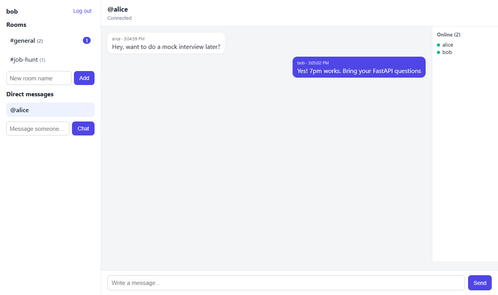

# Realtime Chat

A multi-room chat app with direct messages, unread counts, live messaging over WebSockets, message history, online presence, and typing indicators.

**Live demo:** https://realtime-chat-ru2u.onrender.com (free tier, so the first load after idle can take ~30 seconds). Open it in two browsers to chat between two accounts.



## Features

- JWT authentication; sign in with username or email
- Public rooms with explicit membership
- Direct messages: start a 1:1 conversation by username; new DMs appear for the other person without a reload
- Unread counts per room and DM, stored on the server so they survive a reload or a new device; total shown in the tab title
- Live messages, presence, and typing indicators over WebSockets
- Persistent history with cursor-based pagination ("load older messages")
- Short-lived, single-use WebSocket tickets, so the JWT never appears in a URL
- Per-user message rate limiting
- Auto-reconnect with exponential backoff
- Membership re-checked on every message, so leaving a room takes effect immediately

## Tech stack

- **Backend:** FastAPI (WebSockets), SQLAlchemy 2.0, Pydantic, pytest; SQLite locally, PostgreSQL in production
- **Frontend:** React (Vite), React Router, Axios
- **DevOps:** Docker, GitHub Actions CI, Render (blueprint in `render.yaml`)

## Architecture

```
backend/app/
  core/    config, database session, JWT helpers, ticket store, rate limiter
  auth/    register, login, current-user dependency
  chat/    models, service layer, REST routes, connection managers, WebSocket endpoints
frontend/src/
  api/             axios client, socket opener (fetches a ticket first)
  features/auth/   login and register
  features/chat/   sidebar, chat window, useRoomSocket and useNotifications hooks
```

### REST endpoints (selection)

| Method | Path | Purpose |
|---|---|---|
| `GET` | `/rooms` | Public rooms with `unread_count` |
| `POST` | `/rooms/{id}/read` | Mark messages up to an id as read |
| `GET` / `POST` | `/dms` | List DMs / open (or reuse) a DM with a user |
| `GET` | `/users?q=` | Username search for starting a DM |
| `POST` | `/ws/ticket` | Exchange the JWT for a 30-second, single-use socket ticket |

Full interactive docs at `/docs`.

### WebSocket protocol

Room socket: `/ws/rooms/{room_id}?ticket=<ticket>`

| Direction | Event |
|---|---|
| Client to server | `{"type": "message", "content": "..."}`, `{"type": "typing"}` |
| Server to client | `message`, `presence`, `typing`, `error` |

Notification socket (one per user): `/ws/notifications?ticket=<ticket>` sends an `activity` event when a message lands in any room or DM the user belongs to, which drives the unread badges and surfaces new DMs.

## Run locally

Backend:

```bash
cd backend
python -m venv .venv
source .venv/bin/activate        # Windows: .venv\Scripts\activate
pip install -r requirements.txt
echo "SECRET_KEY=change-me" > .env
uvicorn app.main:app --reload
```

Frontend (second terminal):

```bash
cd frontend
npm install
npm run dev
```

API docs: http://localhost:8000/docs. App: http://localhost:5173. Open a second private window to chat with yourself as another user.

Or run the whole thing in one container (the API serves the built frontend):

```bash
docker build -t realtime-chat .
docker run -p 8000:8000 -e SECRET_KEY=change-me realtime-chat
```

## Tests

```bash
cd backend
pytest
```

42 tests cover auth, room membership, cursor pagination, DMs, unread counts, tickets (expired, reused, wrong user), rate limiting, and real WebSocket flows (broadcast, typing, presence, notifications, refused connections).

## Deployment

The Dockerfile builds the React app in a Node stage, then copies the static files into a slim Python image, so one service serves both the API and the UI. `render.yaml` describes the Render web service; the database is a free Neon PostgreSQL instance passed in through `DATABASE_URL`. New columns are added on startup by a small `ensure_schema()` step, which is enough for this project's size; a larger app would use Alembic migrations.

## Design decisions

- Sockets authenticate with a one-time ticket instead of the JWT: browsers can't set headers on a WebSocket, and a query-string JWT would end up in proxy and server logs. A ticket is useless after 30 seconds or one use
- Unread counts are computed from a `last_read_message_id` per membership rather than stored counters, so there's nothing to keep in sync and reading only ever moves the marker forward
- A DM is a private room with a deterministic name (`dm:<lower id>:<higher id>`), so opening the same conversation twice reuses it and all room features (history, typing, presence) work unchanged
- Rate limiting is a token bucket per user (burst of 5, then 1 message per second), so normal bursts are fine but spam gets an error instead of a broadcast
- Presence tracks users, not sockets, so several open tabs count as one online user
- Database sessions are short-lived and run in a threadpool, so blocking calls don't stall the event loop
- History uses cursor pagination, so new messages can't cause duplicates or gaps
- Known limitation: connection state, tickets, and rate-limit buckets live in one process's memory, so the server runs a single worker. Scaling out would need Redis for pub/sub and shared state

## What I'd add next

- Redis pub/sub so several server instances can share live connections
- Private group rooms with invites
- Message editing and deletion
- Alembic migrations
